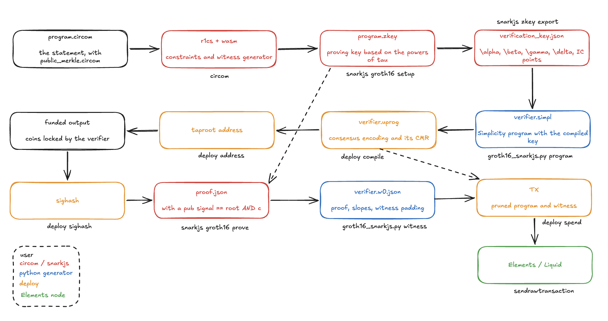

# Simple Groth16

A Groth16 verifier written on [Simplicity](https://github.com/BlockstreamResearch/simplicity). A proof made with [circom](https://docs.circom.io) and [snarkjs](https://github.com/iden3/snarkjs) can spend a Liquid TX output.

> ⚠️ The library is highly experimental and has not been audited. Don't use it in production! To report a vulnerability, see [SECURITY.md](SECURITY.md).

## TL;DR

The library provides a Python generator which compiles a Groth16 verifying key into a Simplicity program that checks 

$$e(A, B) = e(\alpha, \beta) * e(L, \gamma) * e(C, \delta).$$

Simplicity has no pairing jets, so we applied a bunch of tricks to fit Groth16 verifier limits set for Liquid transactions:

- BN254 field arithmetic runs on the secp256k1 field and scalar jets. A product of two BN254 elements is computed exactly modulo both secp256k1 primes, then reduced with [Montgomery reduction](https://en.wikipedia.org/wiki/Montgomery_modular_multiplication) carried out in CRT form.
- Curve arithmetic needs no inversions. Adding or doubling points normally divides to get the slope of a line; here the prover puts every slope in the witness, and the program checks it with a multiplication: `λ * (x2 - x1) = y2 - y1` for an addition, `λ * 2y = 3x^2` for a doubling.
- There is no final exponentiation. The prover supplies a [residue witness](https://eprint.iacr.org/2024/640) (Novakovic and Eagen, 2024), and the program checks a short identity instead.
- The key is compiled in. The lines of gamma and delta are constants, the IC points become lookup tables, and $e(\alpha, \beta)$ is folded into the final comparison.
- The circuit requires a single public signal: the SHA-256 Merkle root of its public values, with the sighash of the spending transaction as leaf 0. The program recomputes that root from its `sig_all_hash` jet, so a proof spends exactly one transaction and cannot be replayed or redirected.

[Design document](docs/design.md) explains each part in more detail.

## Cost

| | |
|---|---|
| program cost, one public signal, padded | 371.8 M mWU |
| transaction | 382.2 kWU, 95.6 kvB |
| pruned program / witness | 161 kB / 220 kB |
| fee at 0.115 sat/vB | ~ 11,000 sat |

The standard transaction limit is 400 kWU, so it's on the border.

## Quick start

Requirements:
- Python 3.10 or later (no packages) and Rust. 
- The circuits require [circom 2](https://github.com/iden3/circom/releases), Node.js 22 or later
- [Elements Core](https://github.com/ElementsProject/elements/releases) 23.3. 

> Tested with rust-simplicity 0.9.0, Elements Core 23.3.1, circom 2.2.2, snarkjs 0.7.6, Python 3.10 to 3.14 and Node.js 22.

```sh
cd tools/harness && cargo build --release && cd ../..   # builds hand and deploy
python3 tests/test_fp.py                                 # field arithmetic
python3 tests/test_groth16.py                            # the whole verifier
```

Each test generates programs for one layer, runs them through `hand` (which executes them the way a node does) and compares every result with the plain-Python model. `tests/test_bn254_ref.py` needs `pip install py_ecc`.

## How it works and a toy example



`circuits/multiplier.circom` is a toy statement: the prover knows `a`, `b` with `a * b = c`. Its public signal is the Merkle root of the sighash and `c`.

1. Build the key and the program:

   ```sh
   cd circuits && npm install && cd ..
   python3 tools/circom_demo.py setup --out build/multiplier
   D=tools/harness/target/release/deploy
   $D compile build/multiplier/verifier.simpl build/multiplier/verifier 
   ```

   `setup` compiles the circuit, downloads a powers-of-tau file, runs the snarkjs setup and writes `verifier.simpl`. `deploy compile` parses it and writes `verifier.uprog`.

2. Get the address and fund it:

   ```sh
   $D address build/multiplier/verifier.uprog elementsregtest
   elements-cli sendtoaddress <address> 1.0
   ```

3. Compute the sighash of the spending transaction:

   ```sh
   G=$(elements-cli getblockhash 0)
   $D sighash build/multiplier/verifier.uprog elementsregtest <txid> <vout> 100000000 <asset> <dest> 100000 --genesis $G
   ```

4. Prove with that sighash. This also checks the proof and writes the verifier's witness:

   ```sh
   python3 tools/circom_demo.py prove --out build/multiplier --sighash <sighash> --a 3 --b 7
   ```

5. Build the transaction and send it:

   ```sh
   $D spend build/multiplier/verifier.uprog build/multiplier/verifier.w0.json elementsregtest \
       <txid> <vout> 100000000 <asset> <dest> 100000 --genesis $G > spend.hex
   elements-cli -stdin sendrawtransaction < spend.hex
   ```

`deploy spend` prunes the program against this transaction and executes it, so a wrong witness fails before anything is sent. You don't need a node for a Liquid testnet -- the faucet funds the address and the transaction can be broadcast through Blockstream's Esplora API (the `liquidtestnet` network in `deploy`).

## Your circuit

Include `circuits/public_merkle.circom`, add a `sighash[2]` input and feed your public values into `PublicMerkleRoot(n)`. Its `root` must be the circuit's only public signal. Then:

```sh
python3 tools/groth16_snarkjs.py program verification_key.json --values n --out build/x
python3 tools/groth16_snarkjs.py witness verification_key.json proof.json public.json --leaves leaves.json --out build/x
```

`leaves.json` is `{"sighash": "<64 hex digits>", "values": ["<decimal>", ...]}`, with the sighash from `deploy sighash` and the values in circuit order. Without `--values`, each public signal becomes a verifier input (8.7 M mWU each) and nothing binds the proof to the transaction.

The program sees only the root, not the values behind it. A contract that must act on a value, say an address the proof commits to, would have to open that leaf as well; the generator does not do that yet.

## Repository

| | |
|---|---|
| `groth/` | the generator: `bn254.py` (plain-Python reference), `sym.py` and `dsl.py` (the two backends and the Simplicity text), `fp.py`, `tower.py`, `curve.py`, `miller.py`, `pairing.py`, `groth16.py` (one layer each), `merkle.py` (the public signal) |
| `circuits/` | `public_merkle.circom` (the public-signal convention) and the toy `multiplier.circom` |
| `tools/harness/` | Rust: `hand` runs generated programs for the tests, `deploy` builds addresses and transactions |
| `tools/` | `groth16_snarkjs.py` (snarkjs key and proof to program and witness), `circom_demo.py` and `regtest.sh` |
| `tests/` | tests (plus `test_bn254_ref.py` against py_ecc) |
| `examples/` | generated programs |
| `docs/` | design notes and benchmarks|

The repository has no hand-written Simplicity: each verifying key gives a different program (1.6 MB of text for the toy circuit), which the tools write into `build/`.

## Credits

- Blockstream Research: for Simplicity, rust-simplicity and SimplicityHL;
- iden3: for circom and snarkjs; 
- Novakovic and Eagen: the residue witness  [On Proving Pairings](https://eprint.iacr.org/2024/640) (2024). 
- py_ecc, which is used to cross-check the reference code.

## License
[MIT](LICENSE)
